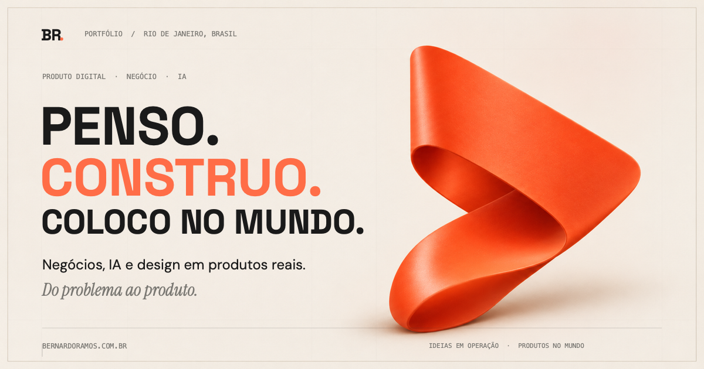
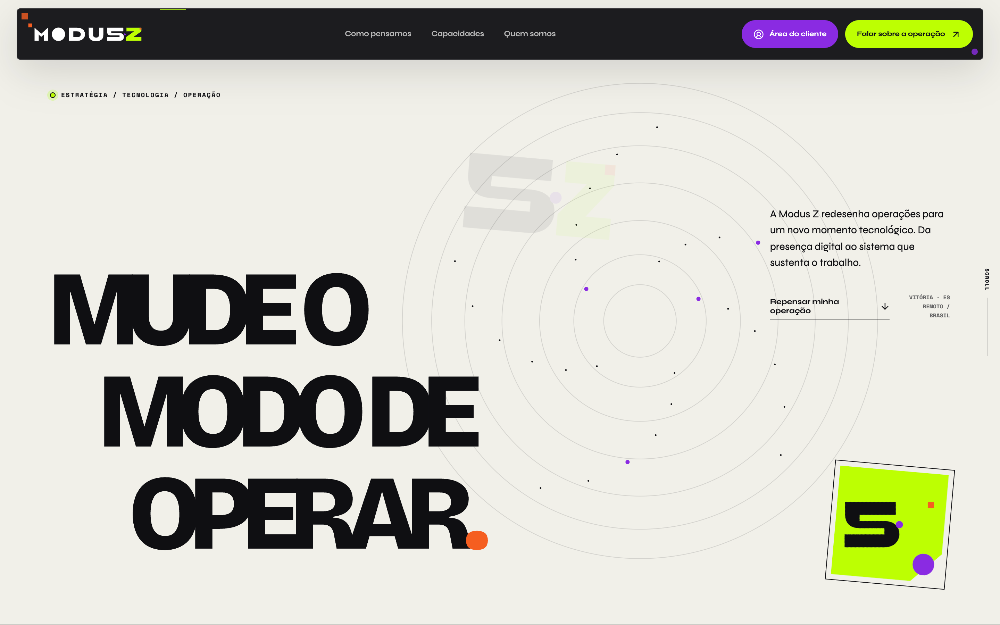
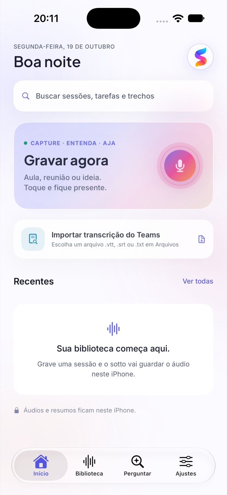
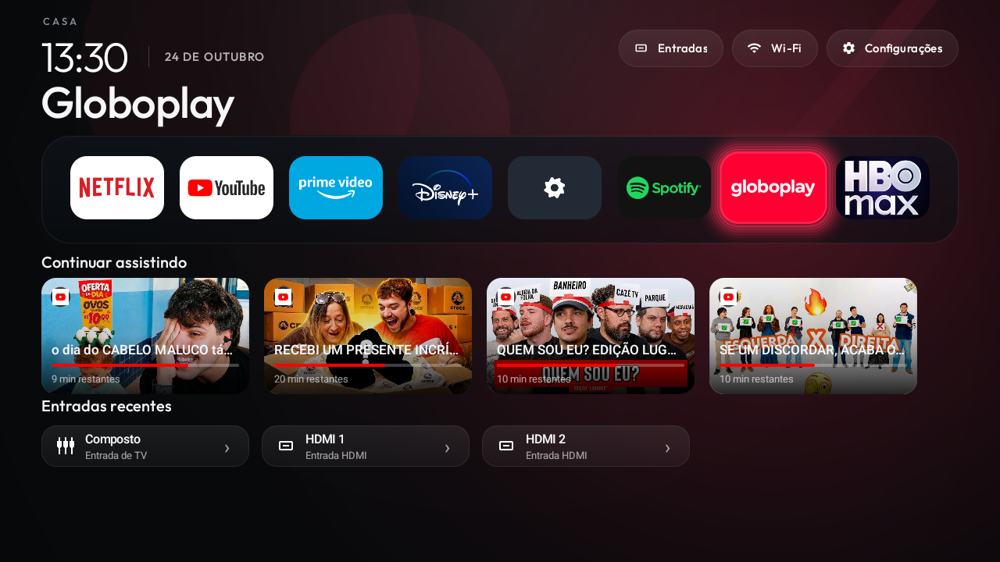

  
  
<a href="https://bernardoramos.com.br">PORTFÓLIO</a> &nbsp;·&nbsp; <a href="https://www.linkedin.com/in/ramos-bernardo/">LINKEDIN</a> &nbsp;·&nbsp; <a href="mailto:berams06@hotmail.com">CONTATO</a>

  
<strong>Administração · produto digital · operação · IA aplicada</strong>

# Bernardo Ramos

Estudo Administração na ESPM e trabalho com Trade Category na L’Oréal. Entendo problemas de negócio e construo produtos, sistemas e automações com IA como ferramenta de trabalho.

A Modus Z começou como meu TCC e virou um empreendimento. Este repositório organiza os projetos que mostram como conecto contexto, experiência e execução.

## Seleção principal

<table>
  <tr>
    <td width="50%" valign="top">
      
      <h3>01 · Modus Z</h3>
      
Meu TCC virou um negócio de sites, sistemas e automações. Também desenho a operação de agentes com contexto, missões e verificações.

      
<a href="cases/01-modus-z.md">Ler o case →</a> · <a href="https://modusz.com.br">Visitar o site</a>

    </td>
    <td width="50%" valign="top">
      
      <h3>02 · Suma</h3>
      
Um app iOS para gravar, transcrever, resumir e retomar reuniões, aulas e ideias com ajuda de IA.

      
<a href="cases/02-suma.md">Ler o case →</a> · <a href="https://bernardoramos.com.br/#case-suma">Ver no portfólio</a>

    </td>
  </tr>
  <tr>
    <td width="50%" valign="top">
      
      <h3>03 · Casa TV + Casa Remote</h3>
      
Uma interface para Android TV e um controle no iPhone que simplificam a navegação entre apps, entradas e teclado.

      
<a href="cases/03-casa-tv.md">Ler o case →</a> · <a href="https://bernardoramos.com.br/#case-casa-tv">Ver no portfólio</a>

    </td>
    <td width="50%" valign="top">
      <h3>04 · TradeFlow</h3>
      
Um fluxo para organizar pedidos de ajuste da rede comercial, aplicar critérios e dar retorno. A demonstração usa dados fictícios.

      
<a href="cases/04-tradeflow.md">Ler o case e abrir a demonstração →</a>

    </td>
  </tr>
</table>

## Mais projetos

| Projeto | O que construí | Evidência |
|---|---|---|
| [Controllist](cases/archive/controllist.md) | Plataforma para convites, QR codes, credenciamento e operação de eventos. | [Site](https://controllist.com.br) e captura atual, identificada como ambiente de validação. |
| [Mercúrio](cases/archive/mercurio.md) | App iOS para planejar o ciclo mensal de compras, itens recorrentes e orçamento. | Três telas reais do protótipo. |
| [Mainstage](cases/archive/mainstage.md) | Protótipo de produto para conectar artistas, gravadoras e fãs. | Site, experiência de fã e painel demonstrativo. |
| [Paulo Horn](cases/archive/paulo-horn.md) | Site para organizar trajetória, propostas e presença pública. | [Site publicado](https://paulohorn2026.com) e captura da página real. |
| [TecksArt](cases/archive/tecksart.md) | E-commerce para apresentar objetos de design autoral. | Capturas do site e catálogo. |
| [ESPM Tech Week](cases/archive/espm-tech-week.md) | Idealização e identidade visual da campanha com apoio de IA. | [Site publicado](https://espm-tech-week.zanelliweb.workers.dev/); implementação feita por um amigo. |
| [Hulkinho](cases/archive/hulkinho.md) | Página compartilhável de produto que organiza as informações e prepara o pedido para WhatsApp. | Captura da página de produto e descrição do fluxo. |

## Como navegar pelo repositório

Cada case resume o contexto, o problema, a solução e minha contribuição. As imagens são identificadas como capturas de produto, demonstrações ou arte editorial. Os limites de protótipos e demos também ficam explícitos. Não publico dados internos da L’Oréal nem apresento números de impacto sem evidência.

As interfaces dos produtos são mostradas por capturas reais. A capa deste repositório é uma peça editorial criada para compartilhamento; ela não representa uma tela de produto. Consulte o [índice de imagens e limites](docs/imagens.md).

## Navegação

- [Quatro projetos principais](cases/)
- [Arquivo de projetos](cases/archive/)
- [Como interpretar as capturas e demos](docs/evidencias.md)
- [Índice de imagens](docs/imagens.md)
- [Portfólio completo](https://bernardoramos.com.br)

## Contato

[LinkedIn](https://www.linkedin.com/in/ramos-bernardo/) · [E-mail](mailto:berams06@hotmail.com) · [Portfólio](https://bernardoramos.com.br)

Rio de Janeiro, Brasil · 2026

