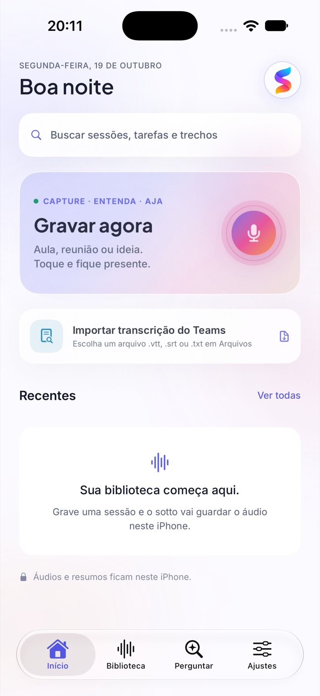
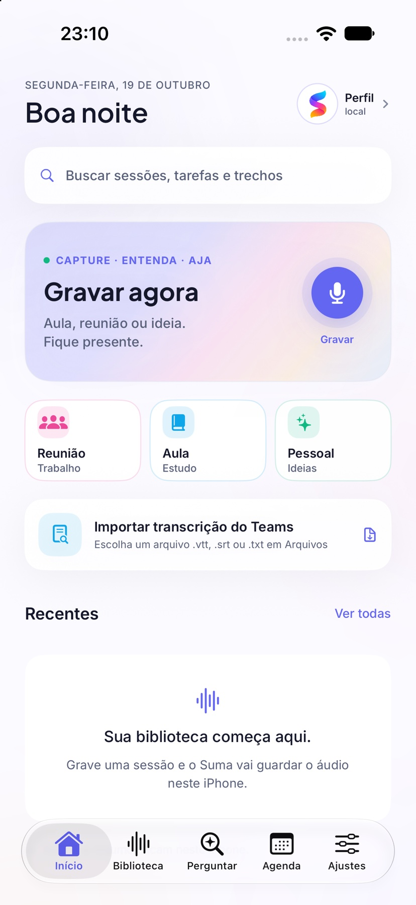
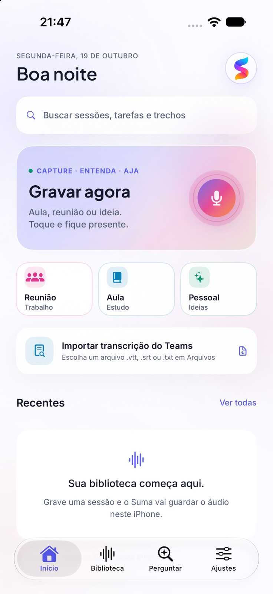

# 02 · Suma

**Produto iOS · reuniões, aulas e ideias**

  
  
  

## Problema

Depois de uma conversa, aula ou reunião, decisões e aprendizados acabam espalhados entre gravações, anotações e tarefas. Retomar o contexto depois pode ser difícil.

## Solução

Um app iOS para gravar sessões, transcrever, organizar o conteúdo com IA, gerar resumos e encontrar trechos importantes quando a pessoa precisar.

## Minha contribuição

Conceito do produto, desenho da experiência e desenvolvimento do protótipo iOS. As três imagens são capturas reais de telas do app.

## Estado atual

O Suma é um protótipo de produto iOS. A demonstração web no portfólio adapta seus principais fluxos para exploração no navegador; ela não é o app nativo nem sincroniza dados com ele.

**Explorar:** [Portfólio](https://bernardoramos.com.br/#case-suma)
