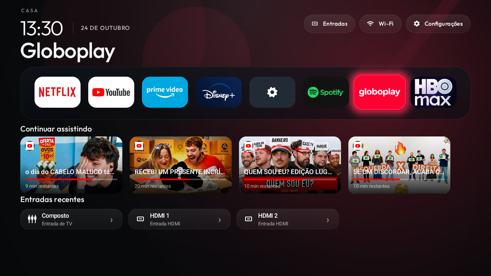
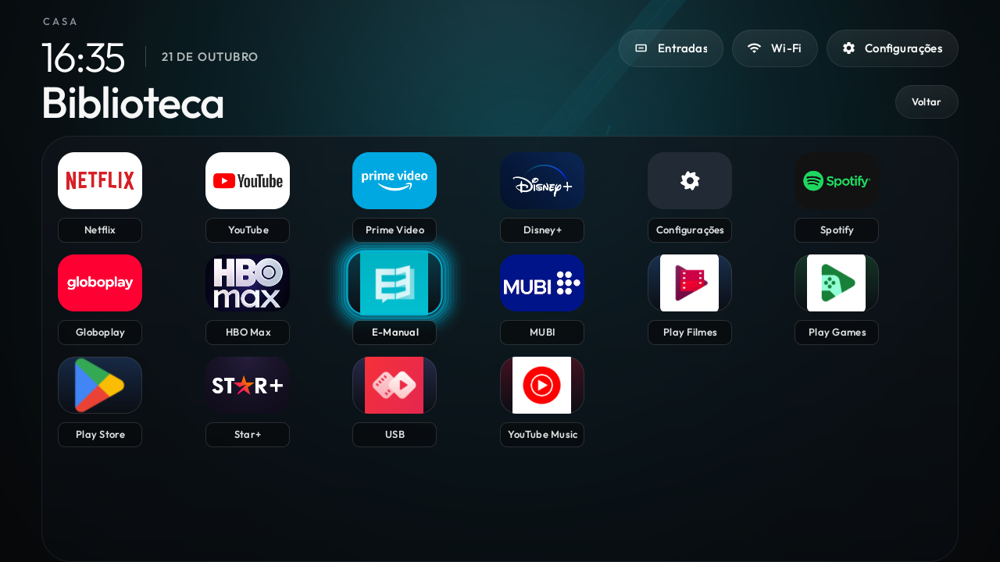
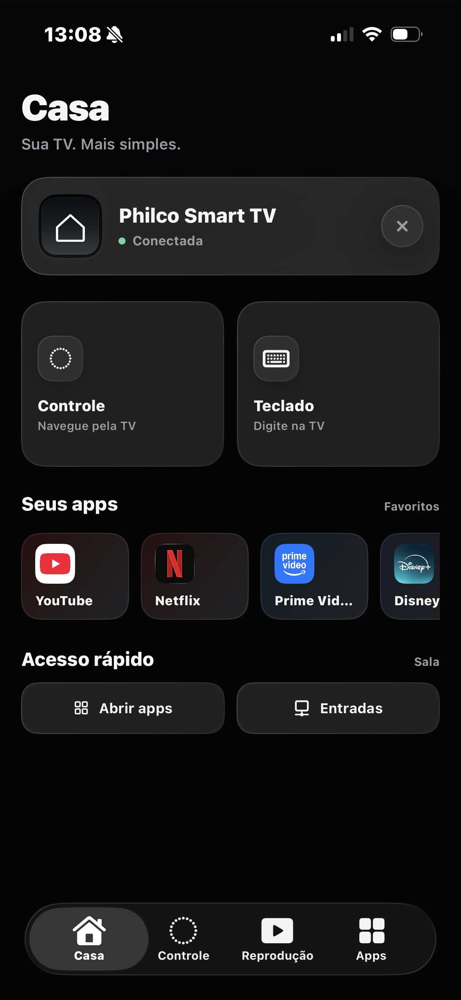

# 03 · Casa TV + Casa Remote

**Interface para Android TV · controle no iOS**

## Problema

Encontrar aplicativos, navegar entre entradas e digitar na TV podia exigir muitos passos com um controle tradicional.

## Solução

Uma interface para TV que organiza apps, conteúdos e entradas, acompanhada por um controle no iPhone com navegação e teclado.

## Minha contribuição

Conceito, UX/UI e implementação do piloto. Desenvolvi os fluxos de TV e iPhone como partes da mesma experiência.

## Estado atual

O piloto foi testado em uma TV Philco. A compatibilidade com outros aparelhos continua em validação. As imagens mostram telas reais do projeto; a demonstração no portfólio é uma simulação navegável, não uma conexão com uma TV física.

**Explorar:** [Portfólio](https://bernardoramos.com.br/#case-casa-tv)
