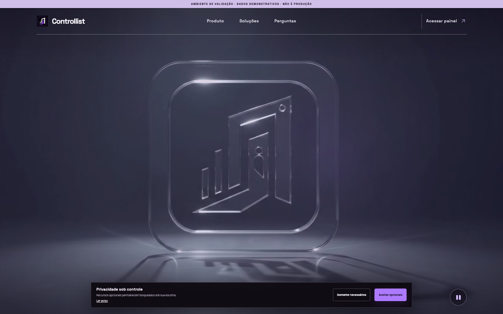

# Controllist

**Plataforma web · eventos · credenciamento**

## Problema

Organizadores de eventos precisam conectar divulgação, convites, lista de participantes, QR codes e entrada em um fluxo que seja fácil de operar.

## Solução

Uma plataforma web para organizar a experiência do evento e apoiar o credenciamento, do convite à conferência na entrada.

## Minha contribuição

Desenhei e desenvolvi a experiência web e os fluxos públicos da plataforma. A captura mostra a interface real da página, incluindo o aviso de ambiente de validação apresentado pelo próprio site.

**Site:** [controllist.com.br](https://controllist.com.br) · O painel exige acesso e não é reproduzido neste repositório.
