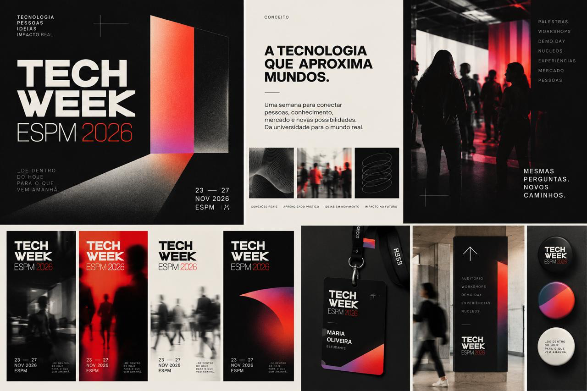

# ESPM Tech Week

**Idealização e identidade visual · campanha acadêmica**

## Contexto

A Tech Week precisava de uma linguagem visual para falar de tecnologia, pessoas e ideias em movimento.

## Minha contribuição

Fiz a idealização e criei a identidade visual da campanha com apoio de IA, incluindo direção de arte, sistema visual e aplicações apresentadas nesta prancha.

## Créditos

Um amigo desenvolveu o site publicado. O trabalho deste case é a idealização e a identidade visual, não a implementação do site.

**Site do evento:** [Abrir a experiência publicada](https://espm-tech-week.zanelliweb.workers.dev/)
