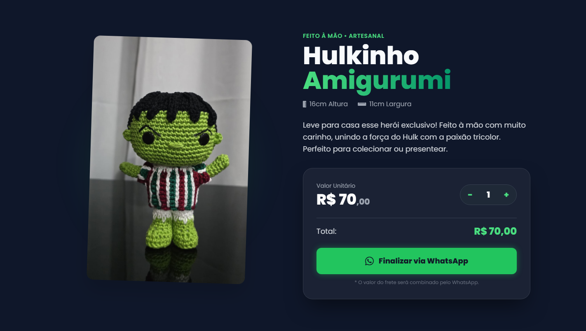

# Hulkinho

**Página de produto · amigurumi artesanal · pedido por WhatsApp**

## Problema

As informações e fotos do produto eram enviadas repetidamente em conversas de WhatsApp. Para entender a peça e montar um pedido, a pessoa precisava trocar mensagens antes de ter tudo em mãos.

## Solução

Criei uma página publicável e compartilhável com fotos, descrição, quantidade e total. A pessoa organiza o pedido pela página e continua a conversa no WhatsApp; na operação real, a API prepara as informações do pedido para revisão e confirmação.

## Minha contribuição

Estruturei e desenvolvi a página do produto e o fluxo que deixa o pedido mais claro antes da conversa.

## Estado da demonstração

A demonstração local calcula o total e prepara o texto para conferência. Ela não abre um destinatário demonstrativo nem envia mensagens.

**Explorar:** [Portfólio](https://bernardoramos.com.br/#arquivo)
