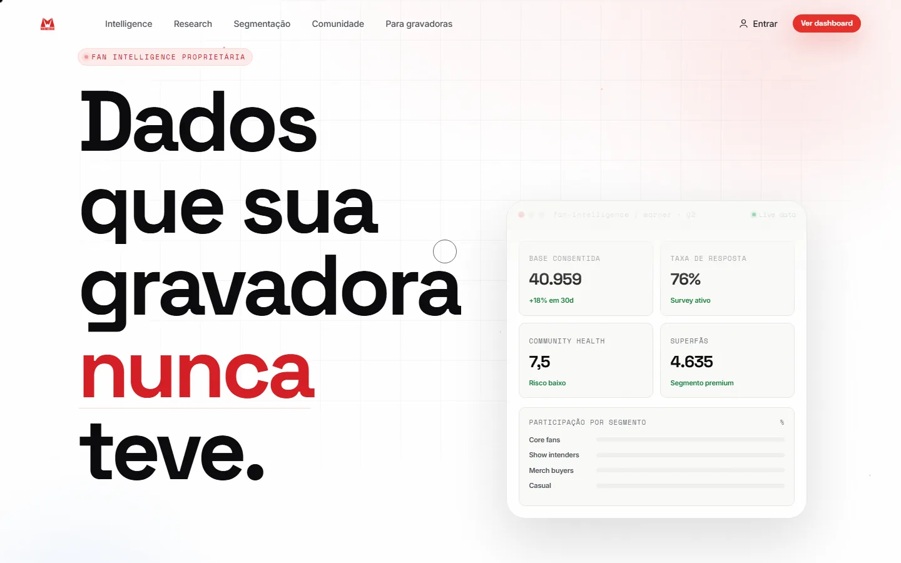
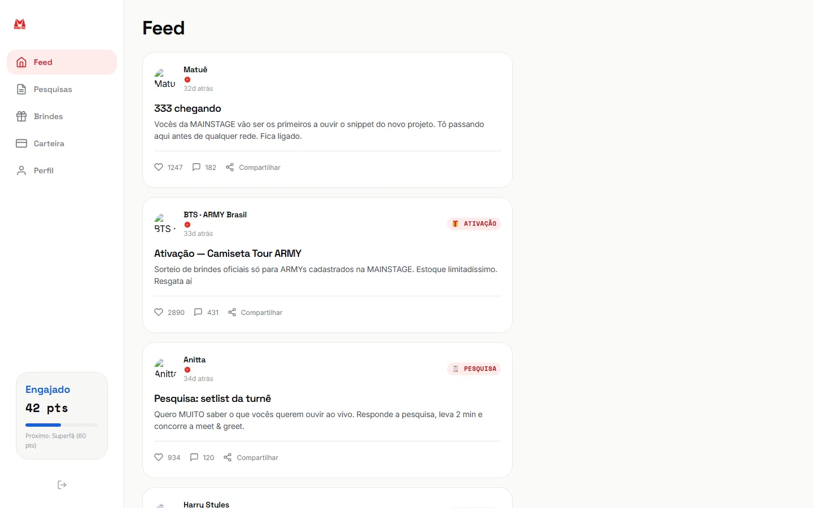
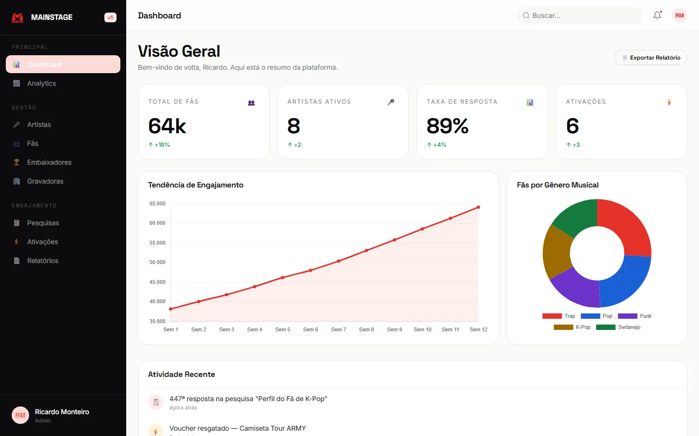

# Mainstage

**Protótipo digital · música · produto B2B e B2C**

  
  

## Problema

Artistas, gravadoras e fãs se relacionam por muitos canais. O projeto explora uma experiência que reúna descoberta de conteúdo e ferramentas para parceiros.

## Solução

Um protótipo de produto com uma experiência voltada aos fãs e um painel B2B para visualizar relações, conteúdo e atividade.

## Minha contribuição

Conceito do produto, estrutura das experiências e desenvolvimento do protótipo. As telas de audiência e os dados do painel são demonstrativos.

**Explorar:** [Portfólio](https://bernardoramos.com.br/#arquivo)
