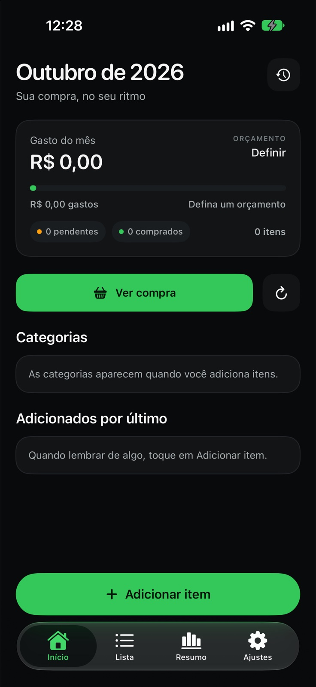
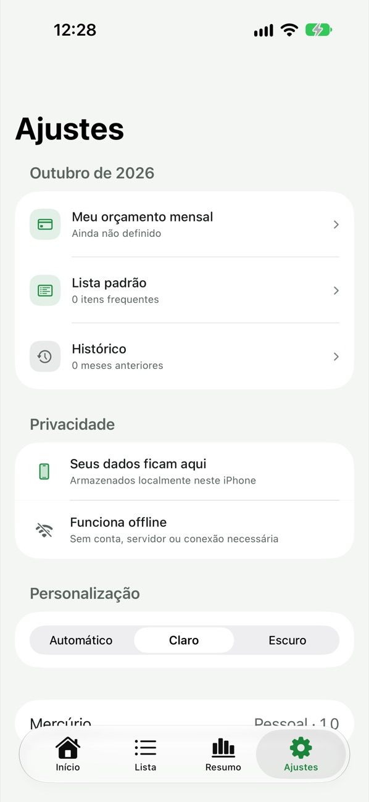

# Mercúrio · Compras do Mês

**App iOS · compras recorrentes · orçamento pessoal**

  
  
  

## Problema

Planejar a compra mensal, lembrar itens recorrentes e acompanhar gastos costuma depender de anotações separadas.

## Solução

Um app iOS organiza o ciclo mensal de compras, a lista padrão, os itens adquiridos, o orçamento e o histórico.

## Minha contribuição

Conceito, UX/UI e desenvolvimento do protótipo iOS. As três capturas mostram telas reais do produto.

## Estado atual

Mercúrio e Compras do Mês são o mesmo produto. A demonstração web do portfólio adapta os fluxos para explorar lista, compra e orçamento; não sincroniza dados com o app iOS.

**Explorar:** [Portfólio](https://bernardoramos.com.br/#arquivo)
