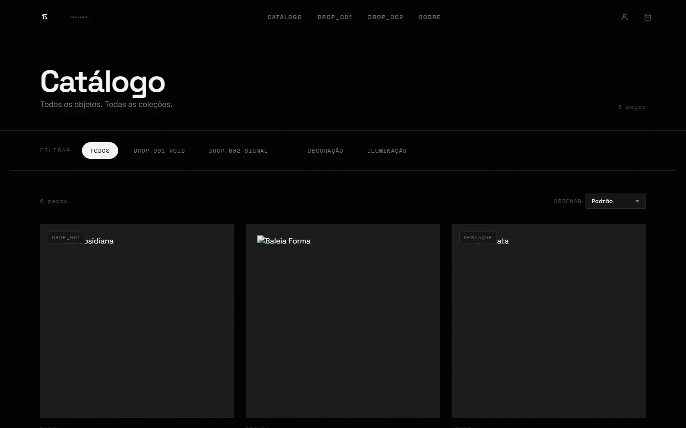

# TecksArt

**E-commerce · objetos de design autoral**

## Desafio

Apresentar peças autorais com uma experiência de compra que valorize o catálogo e facilite a descoberta dos produtos.

## Solução e contribuição

Desenhei e desenvolvi uma vitrine digital com identidade própria, navegação de catálogo e páginas de produto. As capturas mostram o site e o catálogo reais do projeto.

## Estado atual

A demonstração navegável do portfólio ilustra o fluxo de compra. Ela não processa transações reais.

**Explorar:** [Portfólio](https://bernardoramos.com.br/#arquivo)
